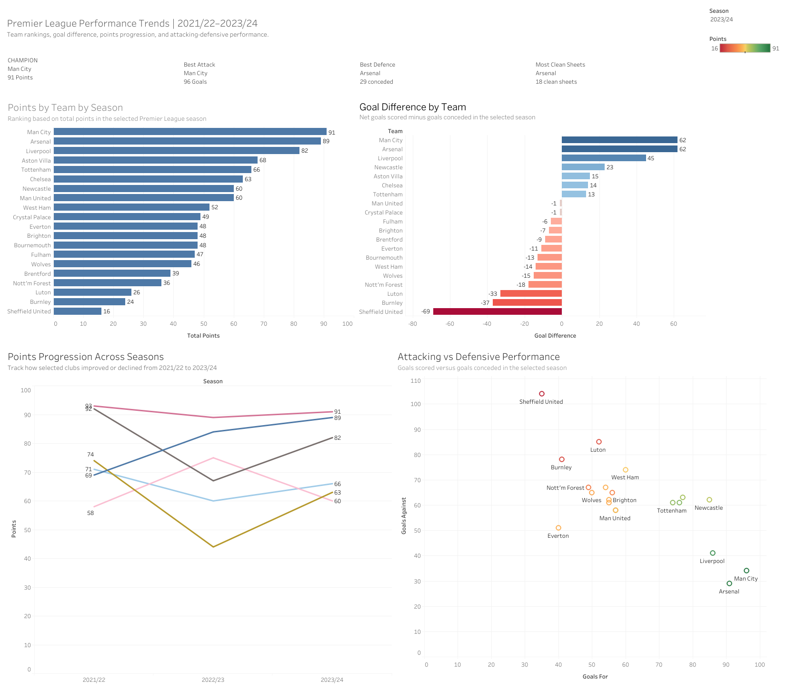

# Premier League Multi-Season Performance Analytics

## Project Overview

This project explores Premier League team performance across three consecutive seasons: 2021/22, 2022/23, and 2023/24.

As a football enthusiast and Manchester City supporter, I wanted to go beyond league standings and understand how different teams performed across multiple seasons.

Using historical Premier League match data, I analyzed key performance indicators such as total points, goals scored, goals conceded, goal difference, and defensive performance.

I used Microsoft Excel for data preparation and Tableau to develop an interactive dashboard that allows users to compare teams, explore seasonal trends, and identify patterns in overall performance.

The goal of this project was to combine my interest in football with practical data analytics skills, focusing on data preparation, performance measurement, visualization, and communicating insights.

## Dashboard Preview

## Interactive Dashboard

View the interactive dashboard on Tableau Public:

[Open Tableau Public Dashboard](https://public.tableau.com/app/profile/parth.nag7346/viz/AnalysisofPremeirLeagueacross3seasonsaa/PremierLeaguePerformanceTrends202122202324)

## Key Features

- Season-specific team points rankings
- Goal difference comparison
- Three-season points progression
- Attacking versus defensive performance
- Champion, best attack, best defense, and clean-sheet KPI cards
- Interactive season filtering

## Data Structure

The repository contains:

- `data/raw/` — original Premier League season datasets
- `data/processed/` — cleaned and transformed Tableau-ready data
- `tableau/` — packaged Tableau workbook
- `images/` — dashboard preview image

## Tools Used

- Tableau Public
- Microsoft Excel
- Data cleaning and transformation
- Data visualization
- Dashboard design

## Key Insights

- Manchester City recorded the highest points total in the 2023/24 season.
- Arsenal matched Manchester City’s goal difference and recorded the strongest defensive performance.
- Liverpool showed a substantial recovery in points between 2022/23 and 2023/24.
- Strong defensive performance clearly separated the leading teams from lower-ranked clubs.

## Seasons Analyzed

- 2021/22
- 2022/23
- 2023/24
